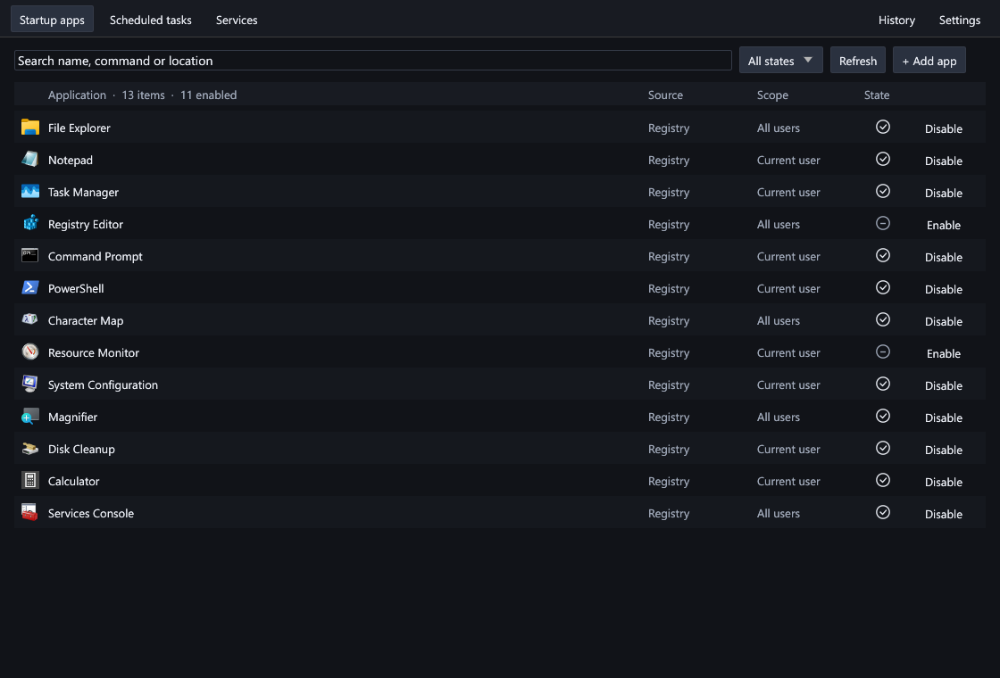
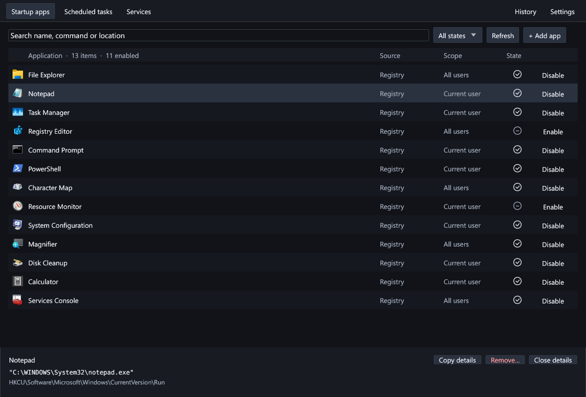
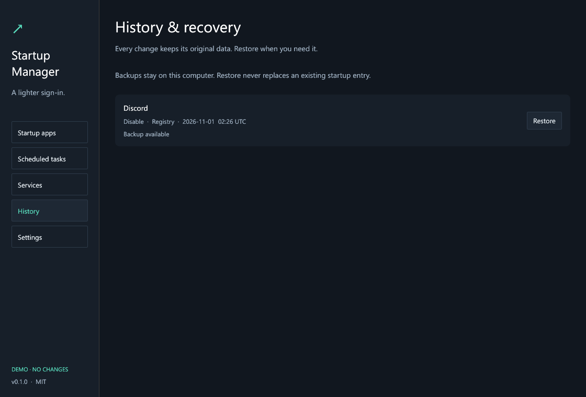
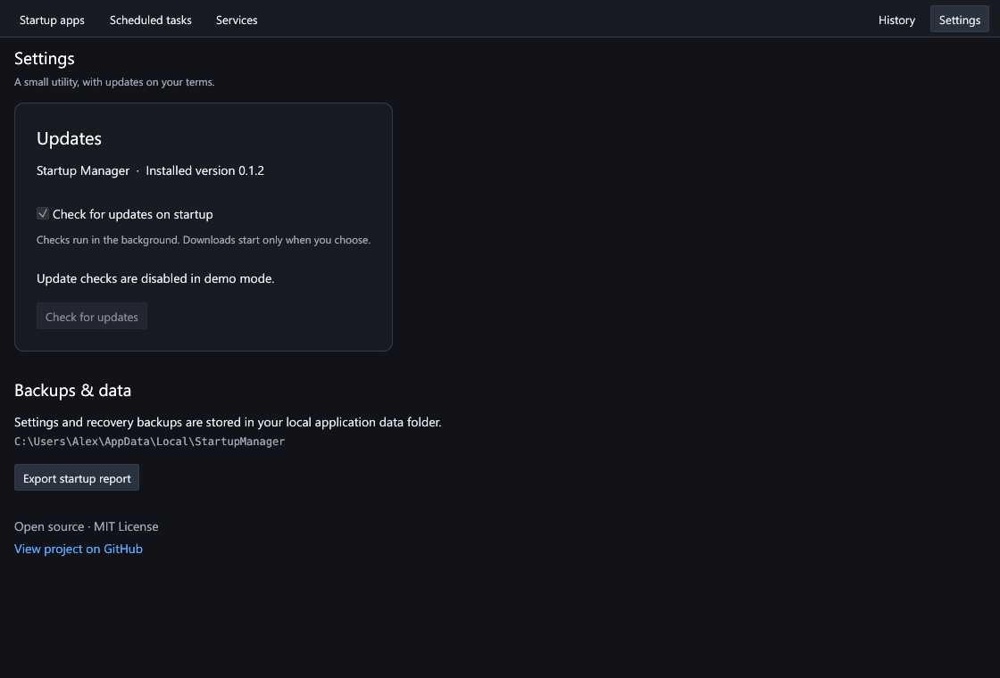

# Startup Manager

A portable Windows startup manager built in Rust. Review what starts with Windows, disable unwanted entries, and restore changes from local backups.



Actual application client area rendered by the production CPU renderer. The 13 example registrations use installed Windows utilities and their real file icons; captures do not change startup configuration.

The list fills the window below a compact navigation strip. At 900 × 620 logical pixels all 13 examples fit without scrolling; at 1120 × 760 they also fit with the selected item's details open. A checked-circle / minus-circle indicates enabled / disabled startup, with full text on hover and in accessibility labels. Flat Enable/Disable actions remain available in every row without a permanent background. The neutral gray palette has no green accents.

Application icons come from executable/shortcut resources on a cached background worker. Missing or inaccessible targets use a standard application icon. Large inventories construct only visible rows; icon extraction and filesystem lookup never run during painting.

## What it manages

| Location | Actions |
| --- | --- |
| Current-user and all-user `Run` / `RunOnce` registry values, including the applicable 32-bit view | Disable, enable, remove, restore |
| User and common Startup folders, resolved through Windows known-folder APIs | Disable, enable, remove, restore; show `.lnk` targets when readable |
| Scheduled tasks with sign-in or boot triggers, including hidden tasks readable by the current account | Disable, enable, remove, restore |
| Automatic and disabled Windows services | Change automatic startup, restore the prior startup mode |

Search names, commands, locations and account scope; filter by enabled state. Add an executable to your own sign-in startup with **Add app**, or export a local JSON inventory from Settings.

This is an on-demand management window. Closing exits the application; it does not need a background tray process. Changing startup behavior does not uninstall an app, terminate a running program, or stop a running service. Changes take effect at the next applicable sign-in, boot or service start.

## Everyday use

1. Open `StartupManager-v0.1.2.exe`. Use **Disable** or **Enable** directly in an application's row.
2. Select an entry to inspect its command/location and access **Copy details** or **Remove…**. **Close details** gives the entire list its height again.
3. Use **History → Restore** to undo a recorded change. Location notices open from the compact toolbar without taking permanent space from the list.



For protected tasks, all-user registry values and service changes, start the application with Windows' **Run as administrator**. Access failures are shown inline; the app does not silently elevate.

## Recovery

Settings, reports and recovery data are stored under `%LOCALAPPDATA%\StartupManager`. A journal is flushed before a mutation. Registry strings retain their original type and bytes; startup files retain their content with SHA-256 verification; tasks keep their XML; services retain the automatic/delayed startup configuration. Added apps also have an undo record.

Restore checks for stale commands, changed task/service state, modified backup files and destination collisions. It refuses to replace a newer entry. Windows startup-approval markers are respected when known, including entries disabled in Task Manager. Incomplete changes remain visible in History for inspection instead of being silently treated as completed. Keep the backups until recovery is no longer needed.



## Updates

The application uses the sibling **rust-auto-updator** core. Settings shows the installed version, **Check for updates**, a persistent **Check for updates on startup** preference enabled by default, and **Download and install** when a newer stable release is available. Checks run in a worker; downloads require a user action and display progress and errors.

The updater selects `StartupManager-vVERSION.exe` and `SHA256SUMS.txt` from this project's canonical GitHub release, verifies the asset, preserves application data, replaces the EXE after exit and restarts. Installation waits for pending startup mutations. No authentication token is required for public release checks. An unpublished repository or missing release is an unavailable update source, not an up-to-date result.



Settings captured in isolated demo mode; network requests and installation are deliberately disabled in that mode. The repository and first release still need publication before online updates can find this application.

## Build

Windows x64 and Rust 1.95 or newer are required. Rust 1.96.1 was exercised. Place the shared library beside this project:

```text
workspace/
  startup-manager/
  rust-auto-updator/
```

```powershell
cargo fmt --all --check
cargo clippy --all-targets --locked -- -D warnings
cargo test --locked
./scripts/package.ps1
```

Use `./scripts/package.ps1 -Offline` when dependencies are already cached. The release links the C runtime statically and produces `dist/StartupManager-v0.1.2.exe`, `SHA256SUMS.txt`, the MIT license and third-party notices. CI checks out the library at `v0.1.0`; publish that repository/tag before enabling consumer CI.

Refresh dependency license attribution with `python scripts/notices.py`. See [verification](docs/VERIFICATION.md) for completed checks and precise limitations.

## Developer diagnostics

```powershell
# Read-only inventory; output may include local commands and account paths.
./dist/StartupManager-v0.1.2.exe --inventory

# Production UI and rasterizer, bounded render-save-exit, isolated example data.
./dist/StartupManager-v0.1.2.exe --capture E:\captures\startup.png startup
./dist/StartupManager-v0.1.2.exe --capture E:\captures\settings.png settings
./dist/StartupManager-v0.1.2.exe --capture E:\captures\compact.png startup 1 900 620

# Finite native visible/settings/hidden/restore test with counters and CPU samples.
./dist/StartupManager-v0.1.2.exe --verify-rendering E:\captures\rendering.json

# Explicit OS integration test: one disposable scheduled task, with no triggers.
cargo test native_task_enable_undo_delete_restore_and_conflict_check -- --ignored
```

Capture screens are `startup`, `selected`, `many` (500 rows), `settings`, `empty`, `error`, and `history`. Optional arguments are scale, logical width and logical height. PNG sidecars record the version, dimensions, scale, frame count, visible-row geometry, resolved icon count and capture scope. Diagnostic modes do not read or save ordinary application preferences and never modify real startup entries.

## Scope

This version covers conventional registry/folder startup, sign-in/boot tasks and Win32 services. It does not inventory every Windows persistence mechanism, packaged-app StartupTasks, drivers, shell extensions or browser add-ons. It does not classify software as malware or predict startup impact.

Service deletion is unavailable. Removing password-backed tasks is refused because their passwords cannot be backed up; disable them instead. Startup folders are non-recursive, and directories, symlinks/reparse points and files larger than 16 MiB are left unchanged with an explanation. Windows policy, protected tasks and read-only executable locations can prevent an operation or update. Recovery comparisons are conservative checks, not a transaction lock against every other system tool.

## License

MIT. See [LICENSE](LICENSE). Dependency attribution is in [THIRD_PARTY_NOTICES.txt](THIRD_PARTY_NOTICES.txt).
